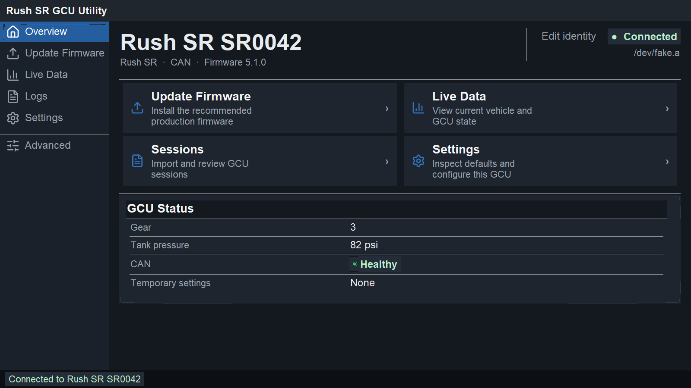

# Rush SR GCU firmware releases

This is where Rush SR owners download firmware for the **Gear Control Unit (GCU)**, the box that runs the car's pneumatic sequential paddle shifter. It holds the release downloads, the release notes, and the flashing guide. The firmware source code lives in a separate, private repository.

The current unit is the **GCU Mk3**, the third-generation GCU. The rest of this page is mostly about it.

## Which GCU is in my car?

Rush has shipped two GCU designs. Check which one you have before you flash.

| | **GCU Mk3** | **Legacy GCU** |
|---|---|---|
| **Fitted to** | Newer builds (Gen2, drive-by-wire) | Earlier builds (Gen1, throttle cable) |
| **Hardware** | Small flat black box, one multicolor LED | Large grey box, two metal connectors, red, yellow, and green LEDs |
| **Firmware** | **5.x** (`.bin` files) | **3.x** (`.hex` files) |
| **USB port** | USB-C on the piggyback harness (dealer-installed if absent) | USB-B on the unit |

Gen1 and Gen2 are car generations, not GCU generations. A Gen1 car has a throttle cable at the pedal box. A Gen2 car has an accelerator pedal sensor and no cable. The GCU Mk3 also reports firmware 5.x when you connect to it.

## The GCU Utility

The GCU Mk3 comes with the **GCU Utility**, a desktop app for macOS and Windows that includes the flasher. It ships in the release download starting with firmware 5.1. Connect a laptop to the car over USB and the Utility lets you update firmware, watch live data, pull session logs, and change settings.

*Overview: the connected car, its firmware version, and a quick health summary, with shortcuts to the other pages.*

## What the GCU Mk3 does

The Legacy GCU fires a valve on a timer and assumes the gear went in. The GCU Mk3 talks to the engine ECU and the AiM dash over CAN and reads its own gear-position sensor, so it knows the gear, the engine RPM, and whether each shift landed.

The **Firmware** column says which release a feature arrives in. The latest release published here is 5.0.0, so check [Releases](../../releases) for what you can download today.

### Shifting

| Feature | What it does | Firmware |
|---|---|---|
| Closed-loop shifting | Watches the gear-position sensor and ends each shift when the new gear is confirmed. Every shift is logged as a success or a failure. | 5.0 |
| Throttle cut and blip | Signals the ECU to cut on an upshift or blip on a downshift, timed to when the gear barrel moves. | 5.0 |
| Money-shift protection | Works out the RPM a downshift would land on, and refuses the shift if it would over-rev the engine. The dash shows why. | 5.0 |
| Missed-shift retry | Retries a 1-2 or 2-1 shift that lands in neutral. Needs a working gear-position sensor. | 5.0 |
| Auto-downshift | Optional. Hold the down paddle and the gearbox walks down one gear at a time, as fast as money-shift protection allows. Stops at 2nd, and letting go of the paddle stops it. CAN cars only. | 5.0 |
| Shift lockout at a standstill | At idle, stopped, with the throttle closed, the paddles are refused so a bumped paddle can't put the car in gear. With a working clutch switch, pull the clutch to shift. On any car, hold N and pull a paddle to leave neutral, or pull the paddles three times quickly to turn it off until the next power cycle. On by default, CAN cars only. | 5.1.1 |
| Per-gear shift trims | A separate timing trim for each gear change, so one stubborn shift can be adjusted without touching the rest. | 5.1.2 |

### Air system

| Feature | What it does | Firmware |
|---|---|---|
| Compressor control | Keeps the tank between a cut-in and a cut-out pressure. You can change both. | 5.0 |
| Compressor watchdog | If a refill stops building pressure or the tank sensor reads garbage, shuts the compressor off and keeps it off. The fault is logged and sent to the dash. A power cycle clears it. | 5.1 |
| Compressor wiring setting | A running compressor can pull the gear-position reading low, and the GCU corrects for that by default. If your shift harness runs the compressor ground straight to the battery, set `relay_flyback_installed` to 1 to turn the correction off. It survives firmware updates and Restore Factory Settings. | 5.1 |

### Logging and data

| Feature | What it does | Firmware |
|---|---|---|
| On-board session logging | Writes every shift, refusal, and fault to the GCU's flash memory, stamped with the AiM dash's GPS clock. Logs survive a power cycle, so a whole weekend's history can be pulled in the paddock. | 5.0 |
| Logs page | Imports sessions from the GCU to your laptop, summarizes each one, and opens or exports the full report. Importing never deletes anything from the GCU. | 5.1 |
| Live data | Shows gear, shift state, RPM, tank pressure, and CAN health as they happen. | 5.0 |
| Dash alarms over CAN | Sends the dash a warning for each refused shift (money shift, top gear, lowest gear, low RPM), high tank pressure, stale ECU data, and CAN faults. From 5.1 every active warning shows at once and clears when the cause is gone. 5.1.2 adds a gear-position sensor fault, lost closed-loop shifting, and a count of back-to-back failed shifts. Your AiM config decides which ones show as alarms. | 5.0 |
| Session fuel used | Adds up the ECU's fuel channel into a running total for the session and sends it to the dash. Treat it as a relative figure until it has been calibrated against a fill-up. | 5.1 |
| Brake light | On cars wired for it, switches the brake light from measured brake pressure. If the pressure signal is lost, the light stays on. | 5.0 |

The [owner's manual GCU Mk3 page](https://manual.rush.sr/maintenance/electronics-and-wiring/gcu/gen3) has the full detail: settings, LED codes, dash channels, and how to read a log.

## Get the firmware

Download the latest release from [**Releases**](../../releases). Each release zip contains the firmware for the matching unit and the app to flash it:

- **GCU Mk3 (5.x):** `release_CAN_feather-X.X.X.bin`. From 5.1.1 the download also carries `release_KLine_feather-X.X.X.bin`.
- **Legacy GCU (3.x):** `release_CAN-X.X.X.hex` or `release_KLine-X.X.X.hex`

## Flash it

- **GCU Mk3:** follow [Flashing firmware](https://manual.rush.sr/maintenance/electronics-and-wiring/gcu/gen3#flashing-firmware) on the manual's [GCU Mk3 page](https://manual.rush.sr/maintenance/electronics-and-wiring/gcu/gen3). You need a laptop, a USB-C cable to the harness piggyback, and the car powered on.
- **Legacy GCU:** follow [`docs/flashing.md`](docs/flashing.md). You need a USB-B cable and the GCU Flasher app.

## Version history

[`CHANGELOG.md`](CHANGELOG.md) is the source of truth for what changed in each release. Versions 3.0.3 and earlier are not published here. Contact Rush Auto Works if you need one.

---

*Maintained by Rush Auto Works. The [owner's manual GCU pages](https://manual.rush.sr/maintenance/electronics-and-wiring/gcu/README) mirror this repo's releases.*
